# mindthegap {.unnumbered}

An R package for Agent Based Modelling (ABM) of whole blood donors donating at stochastic intervals.

# Overview

## Themes / Analytical methods

_Packaging R code, OOP R6 classes, System Dynamics, Agent Based Modelling, Monte Carlo Methods, composite metrics, Multi-Criterion Decision Analysis_

## Business Problem

European law allows more frequent donation than NHSBT currently allows in England, so would it be a good idea to let people donate more frequently?

### Academic Aim

On reducing the minimum allowed interval between successive blood donations, does any
increase in blood supply significantly outweigh any deterioration of body iron health in
donors?

## Scoping and planning

After interviewing clinical stakeholders, I decided I needed model that simulated blood donor behaviour and their instances of successful donations over a fixed time horizon. I established that the distribution of the number of donations made by each simulated donor, and the intervals between them, should be a function of:
* The minimum interval allowed by the organistion
* The donor’s individual preferred interval between donations
* The time required for the donor’s blood iron levels to replenish sufficiently to pass the pre-donation Haemoglobin
(Hb) test

A reduction in the minimum interval is should increase the total number of donations
from donors over a fixed period of time, accompanied by an increase in the frequency and
severity of adverse effects on donors’ body iron health. I established that the model should allow the user
to observe the effect of varying the minimum allowed interval by returning a quantified set of outcomes, pertaining to blood supply and donor body iron health.

I recognised that the model mechanics and outputs should be transparent, explicit, and granular enough for a practitioner to draw quantitative, parameterised insights and statistical expectations surrounding this tradeoff. Model outputs should
be accessible and practical enough to inform a recommendation for an operational intervention
or policy.

## Assumptions

Key assumptions relate to:

* The sequence of steps that sufficiently capture the process of a donor choosing to donate blood, through to the physical donation
* Distributions governing how long after their last donation a donor will next choose to donate
* The dynamics of iron in the human body (especially replenishment) that govern whether a donor passes the pre-donation Haemoglobin test

## Limitations {#limitations}

The main limitation of this work is one that is inherent to modelling two extremely complex domains - human altruistic behaviour and biology. As such, I conducted the literature review and model design so that the model faithfully captured the drivers and effects in the real-world system, while allowing me to write, validate, and communicate a model, in reasonable time, that was accessible, reproducible, and not over-parameterised. 

## Technical choices

* I recognised the suitability of Agent-Based Modelling (ABM), given the idiosyncratic and behavioural nature of donors choosing to donate. A good model would require fine control over a range of different parameters and variables. 

::: {.panel_tabset}

### Agent Based Model overview

### ABM example

### Example parameters and variables

:::

* I decided to develop an R package to allow for reproducibility and to facilitate comparison of different customised scenarios. The donors, equipped with their preferences, variabiality, and complex iron dynamics, presented a good use case for an Object Oriented Programming approach using R6 Classes. Donor objects are instantiated, equipped with their own stochastic characteristics, behaviour, and iron replenishment mechanics.
* I used a Monte Carlo Method (MCM) with hierarchical sampling to simulate a stochastic system of a population of such donors, observing the distribution of outcomes.
* Following the MCM I computed a composite metric of a linear combination of donation volume and permanent deferral occurrences (after three failed pre-donation Haemoglobin tests, donors cannot return). This allowed reduction of competing objectives into a simple figure for ease of comparison between scenarios.
* I included observables relating to "wasted slots" and donor burnout, for scope to extend the composite metric to include other priorities.

## Validation
Model outputs from the baseline scenario (current minimum interval rules) were compared with operational data to ensure they were within a reasonable variance. The observables tested included rates of donation given attendance, rates of Hb rejections, and rates of permanent deferrals.

## Impact
As discussed in @results, the work allowed me to accessibly and tangibly demonstrate a finding in the literature (conducted by a different blood service), which had not been explored in the English blood service - that Hb testing alone is an insufficient marker for iron health and fitness to donate. On presenting and discussing the results with the organisation's Associate Medical Director of Donor Medicine and Plasma for Medicines, plans to implement the shorter minumum intervals were suspended.

# Project code
In lieu of a link to the repo, which is not public, the below explores the architecture, pseudocode, and code excerpts, from the repo.

## Architecture

::: {.panel-tabset}

### Package directory tree

### Package namespace

### Tests

:::

## Pseudocode

::: {.panel-tabset}

### Mathematical formulation of model
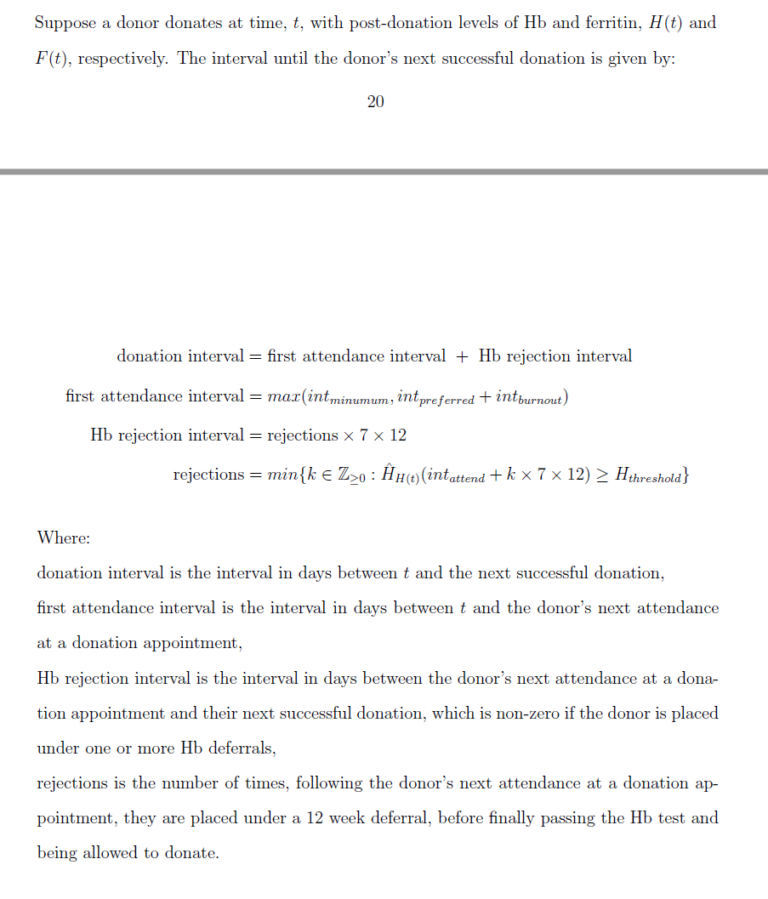

### Algorithm for modelled process flow
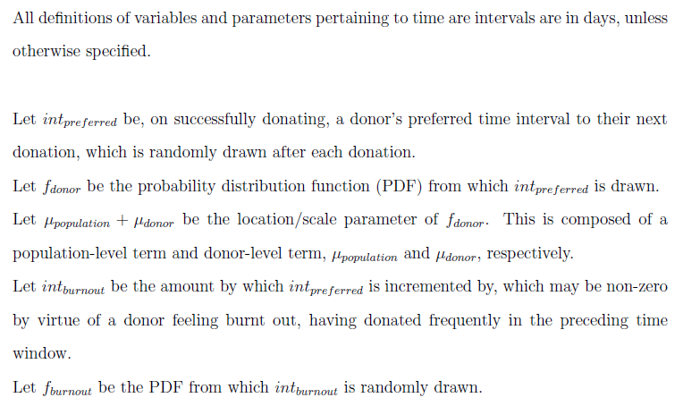

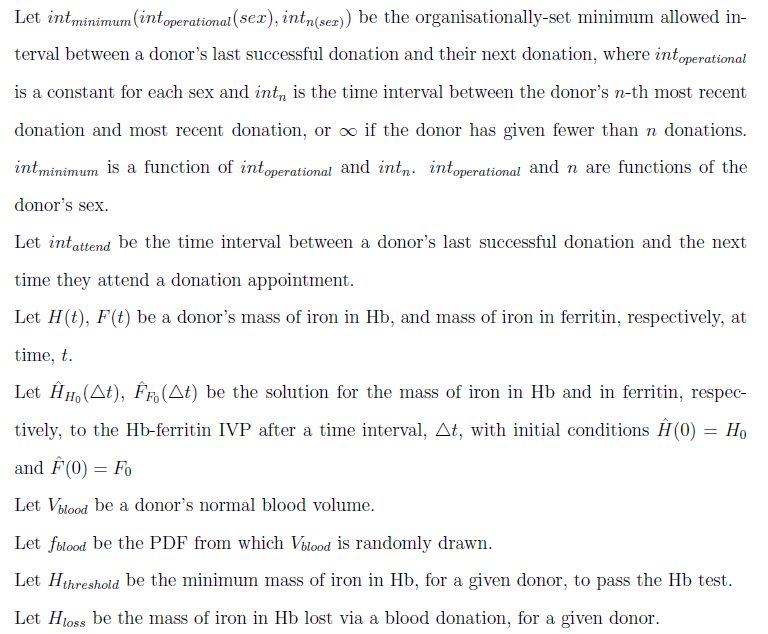

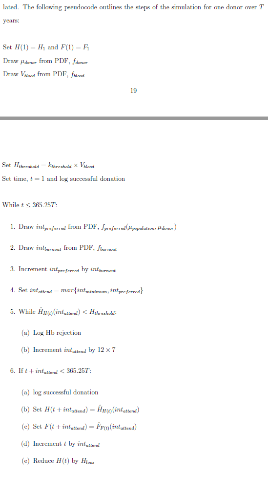

### Composite metric for scenario comparison
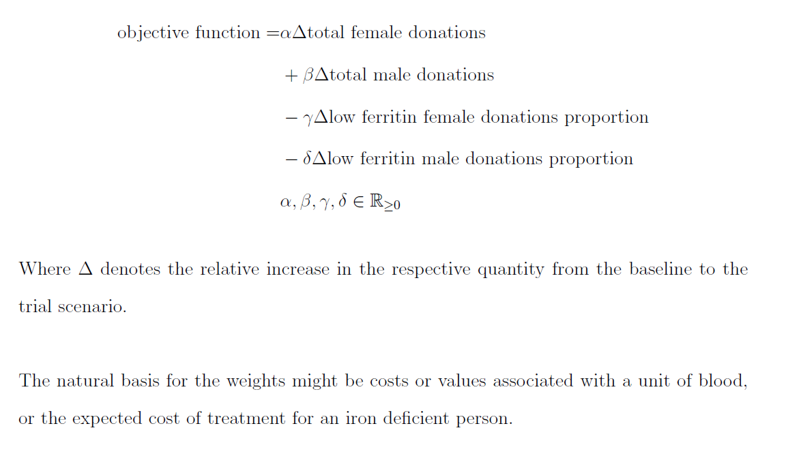

:::

## Code excerpts

::: {.panel-tabset}

### The Donor R6 Class

### Example public methods

### Tests

:::

## System Dynamics for modelling iron replenishment

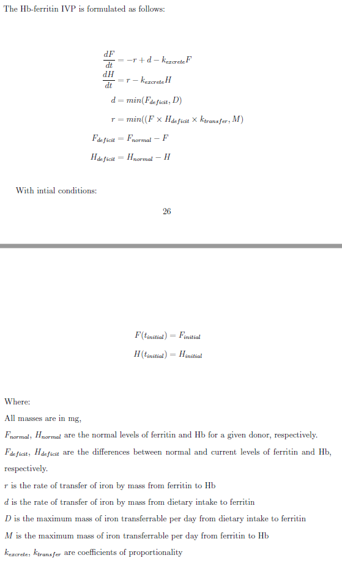

# Results {#results}

The simulations demonstrated an effect discussed in the literature, that Hb levels are not a complete marker for iron health. This is because iron is also stored in a buffer protein, ferritin. Allowing donors to donate purely based on good Hb levels risks allowing donations to occur while ferritin stores are depleted. The simulations also demonstrated an inequality in outcomes whereby donations from donors assigned at birth female are more likely to be given while in poor iron health compared with those from donors assigned at birth male.

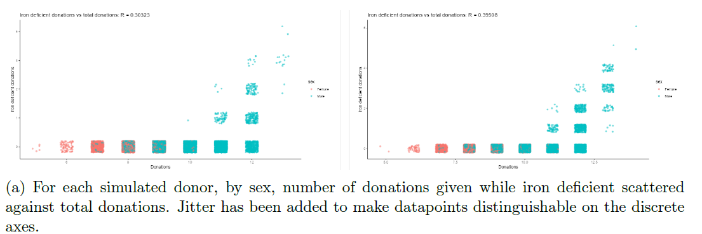

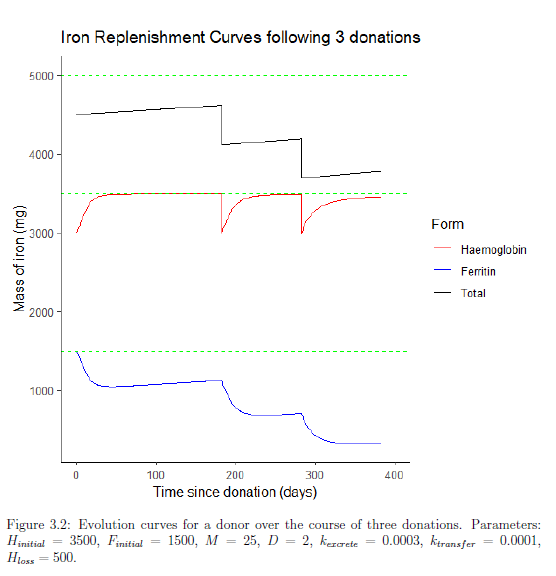

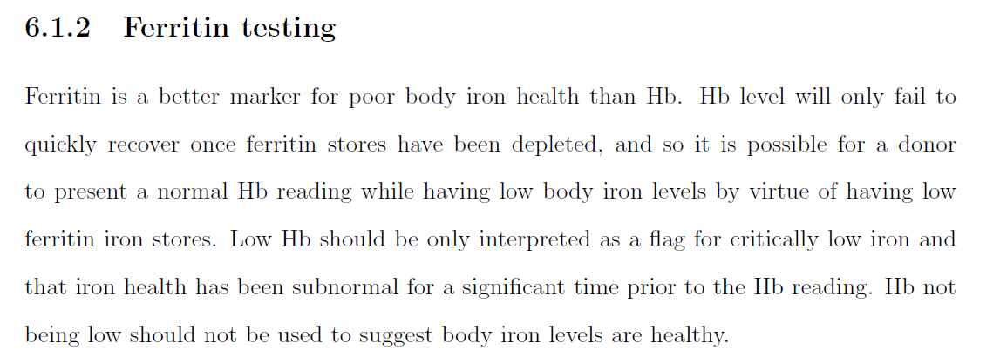

# Raw Outputs

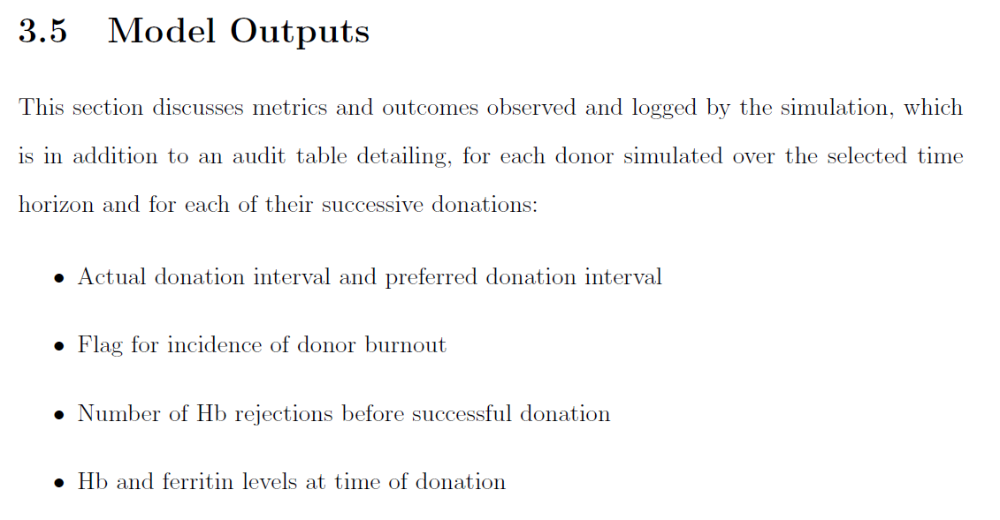

::: {.panel-tabset}

### User guide

### Documentation

:::

# Relevance to the Senior Data Scientist role

## Packages
Packaging code allows for reproducibility and collaboration, both inside and outside the organisation. My experience in developing packages also makes we well positioned to contribute to the ICB's existing packages such as NCLRtemplates.

## Agent Based Models
As discussed in @limitations, modelling behaviour and outcomes of people in a healthcare context is complex and stochastic. People are individualistic intersections of demographics, motivations, and biology. As such, my work in ABM and Monte Carlo Methods is directly transferrable to a range of domains concerning the ICB requiring forecasting, comparison, and evaluation of different interventions and policies.

# What I learnt / would improve
* I would extend the objective function to allow for better quantification of outcomes. Below is an example to include the cost of healthcare for people with iron deficiency. It is also partitioned to capture any differentials in the demand of blood from different groups of people and the cost of treating different groups of people.

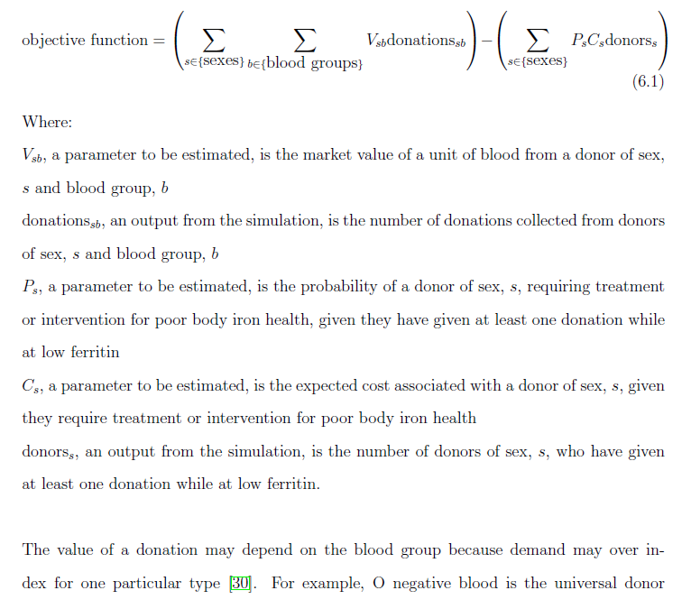

* I included a parameter to adjust for different population-level normal Hb levels. I would use this to explore inequalities affecting populations of people who have lower normal levels of Hb - this is directly applicable to the observation in the organisation that Black African and Black Caribbean attendees are more likely to experience Hb rejections than other people.