# mindthegap {.unnumbered}

An R package for Agent Based Modelling (ABM) of whole blood donors donating at stochastic intervals.

# Overview

## Themes / Analytical methods

_R package, OOP with R6 classes, coupled ordinary differential equations for System Dynamics, Agent Based Modelling, Monte Carlo Methods,  Shiny app, composite metric, Multi-Criterion Decision Analysis_

## Business Problem

European law allows more frequent donation than NHSBT currently allows in England, so would it be a good idea to let people donate more frequently?

### Academic aim

On reducing the minimum allowed interval between successive blood donations, does any
increase in blood supply significantly outweigh any deterioration of body iron health in
donors?

## Scoping and planning

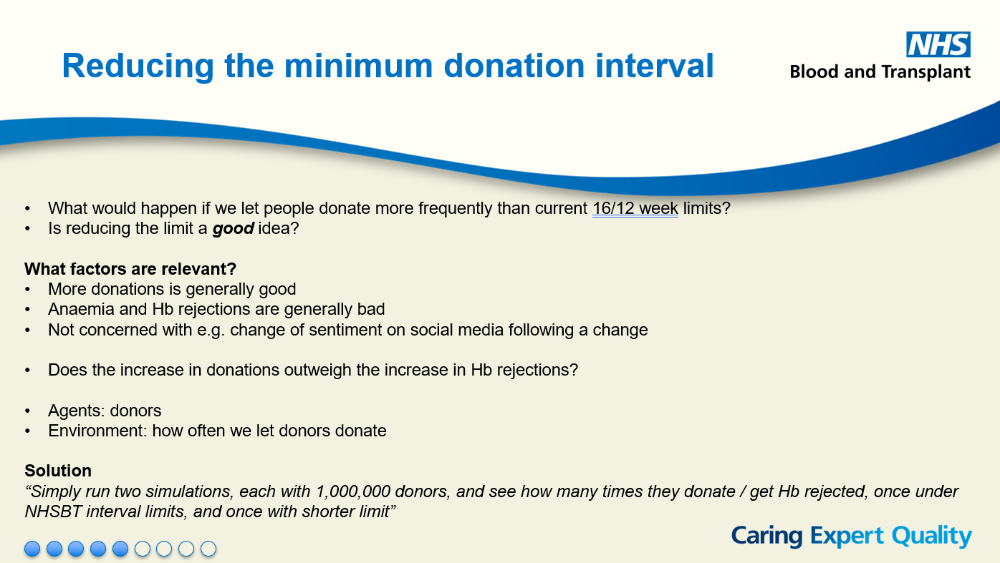

After interviewing clinical stakeholders, I recognised the aim of the model should be to simulate a cohort of blood donors and their instances of successful blood donations over a fixed time period. The distribution of the number of donations made by each simulated donor, and the intervals between them, should be expected to be a function of:
* The minimum interval
* The donor’s individual preferred interval between donations
* The time required for the donor’s blood iron levels to replenish sufficiently to pass the
Hb test

A reduction in the minimum interval is expected to increase the total number of donations
from donors over a fixed period of time, accompanied by an increase in the frequency and
severity of adverse effects on donors’ body iron health. The model should allow the practitioner
to vary, as an input parameter, the minimum allowed donation interval, and should
return a quantified set of donor outcomes, pertaining to blood supply and donor body iron
health.

Model methodology and outputs should be transparent, explicit, and granular enough for a practitioner to draw quantitative, parameterised insights and statistical expectations surrounding the tradeoff
between blood supply and donor body iron health. Simultaneously, model outputs should
be accessible and practical enough to lend themselves to a solving a cost-benefit analysis
rooted in that trade-off, and to reasonably inform a recommendation for an operational intervention
or policy.

## Assumptions

Key assumptions relate to:

* A sequential process flow for a donor choosing to donate blood through to the physical donation
* Distributional assumptions governing how long after their last donation a donor will choose to donate
* The dynamics of iron in the human body (especially replenishment) that govern whether a donor passes the pre-donation Haemoglobin test

## Limitations

## Technical choices

* I recognised the suitability of Agent-Based Modelling (ABM), given the idiosyncratic and behavioural nature of donors choosing to donate. A good model would require fine control over a range of different parameters and variables. 

::: {.panel_tabset}

### Agent Based Model overview

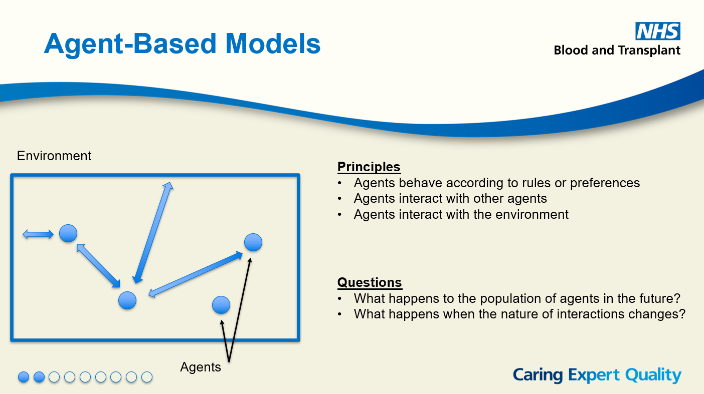

### ABM example

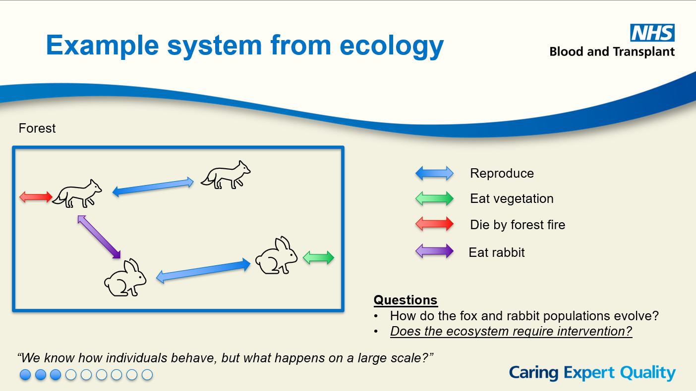

### Example parameters and variables
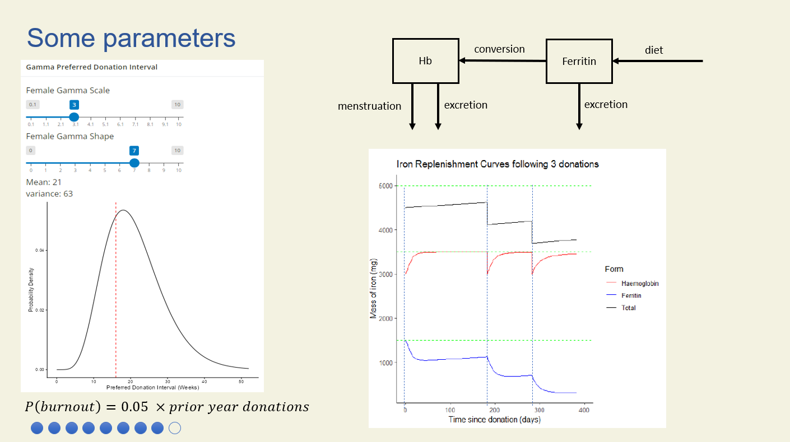
:::

* I decided to develop an R package to allow for fine control over testing different scenarios under different parameters. The donors, with their preferences, variabiality, and complex iron dynamics, warranted the use of an Object Oriented Programming approach using R6 Classes. Donor objects are instantiated, equipped with their own stochastic characteristics and behaviour, and iron replenishment mechanics.
* I used a Monte Carlo Method with hierarchical sampling to effectively and efficiently simulate a highly stochastic system of a donor's donation activity.
* I used a composite metric of a linear combination of donations and permanent deferrals (after three failed pre-donation Haemoglobin tests, donors cannot return)
* I included observables relating to "wasted slots" and donor burnout, for scope to extend the composite metric

## Validation

## Impact  

# Project code
In lieu of a link to the repo, which is not public, the below explores the architecture, pseudocode, excerpts, and outputs relating to the repo and project.

## Architecture

::: {.panel-tabset}

### Package directory tree
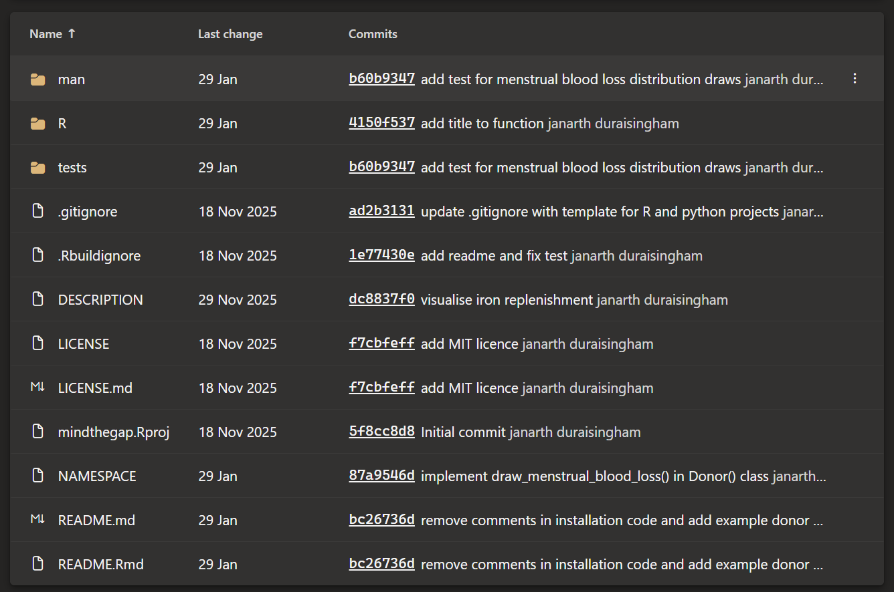

### Package namespace
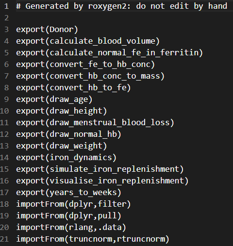

### testthat
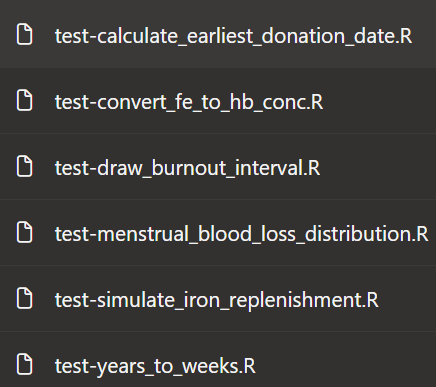

:::

## Design choices

## Pseudocode

::: {.panel-tabset}

:::

## Code excerpts

::: {.panel-tabset}

### The Donor R6 Class

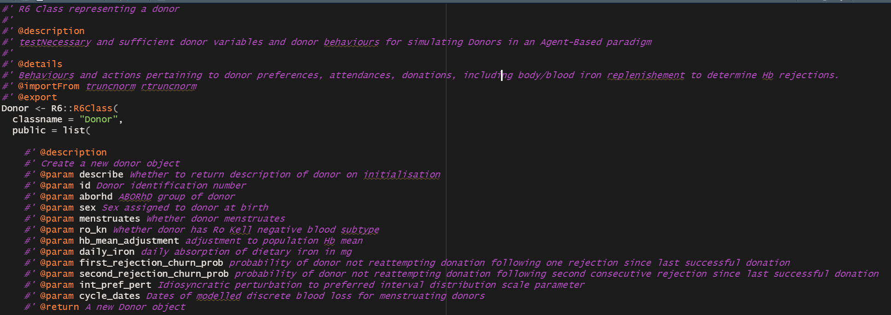
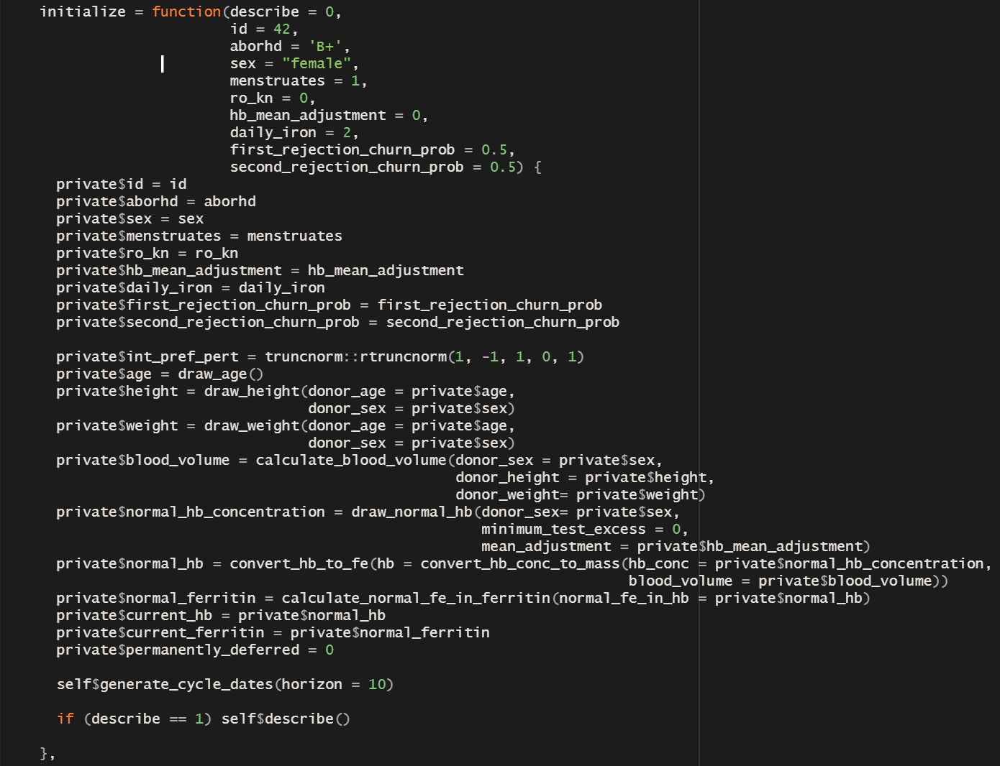

### Example public methods

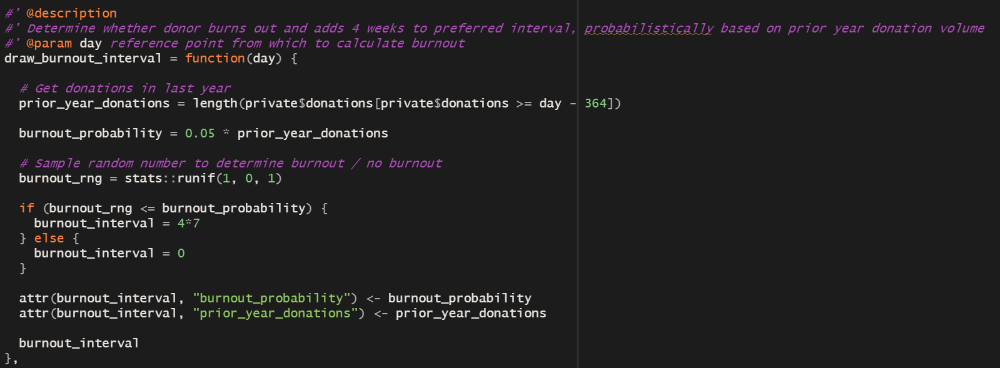
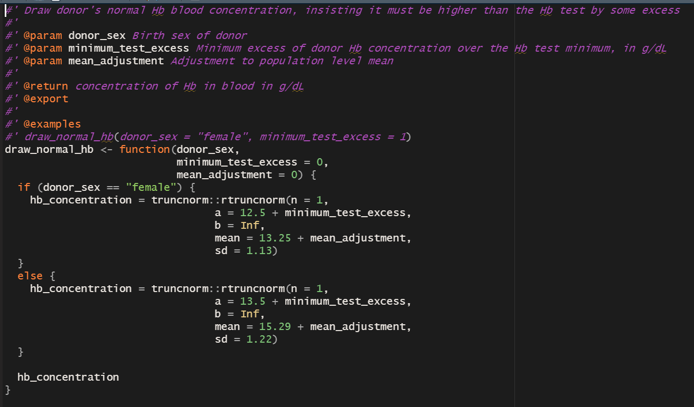

### testthat tests
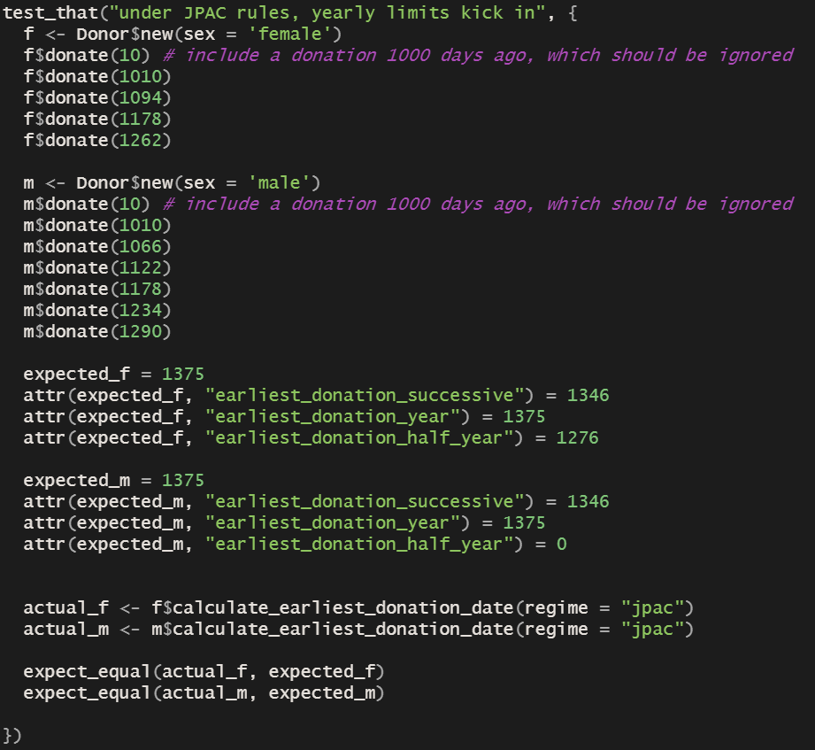

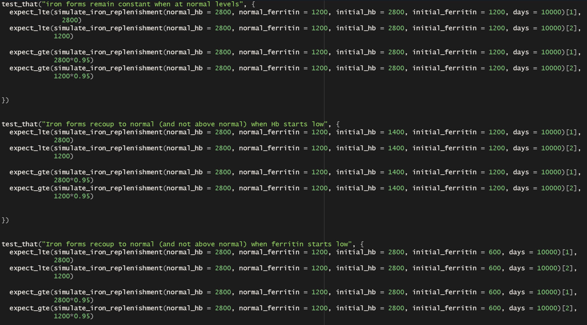

:::

# Output

::: {.panel-tabset}

### User guide

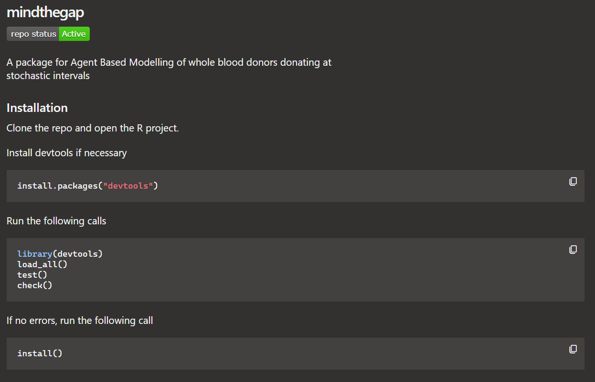
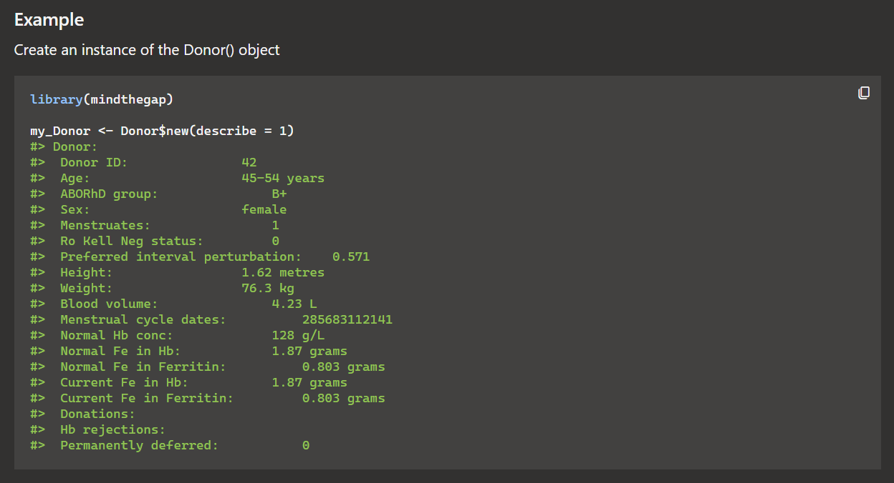

### Documentation
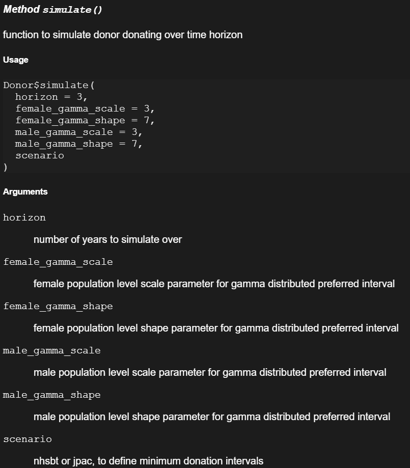
:::

# relevance to role
solving unstructured problems by combinig different technique.

# What I learnt/would improve